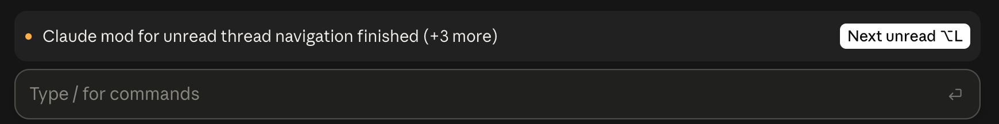

# next-unread

Conductor-style unread threads for the Claude desktop app.

When a thread in the Code tab finishes, asks a question or needs your approval while you are in another thread, every other thread shows a notice above the prompt box. `⌥L` jumps to the oldest unread thread.



## Install

Type this in a `claude` session in a terminal. The command does not exist in the desktop app's Code tab, but a user-scope install loads there too.

```
/plugin install next-unread --marketplace sanderjn/claude-next-unread
```

Run `/reload-plugins` in threads that are already open. Needs macOS and a Claude Code version with mods (built on 2.1.293).

## Use

- `⌥L` in any prompt box, the **Next unread** button, or `/next-unread`.
- A thread is unread when its turn ended, it asked a question or it needs your approval while off screen, until you open it or send it a prompt.
- On another keyboard layout, set the `key` option to the character your Option combination types. The default `¬` is what `⌥L` types on a US or Dutch keyboard. `⌘` combinations are not possible.

## Shortcut without the prompt box

A mod only sees keys typed in the prompt box. For a shortcut that works wherever the focus is, use the script in [`raycast/`](raycast/next-unread.sh): in Raycast, add that folder under Settings → Extensions → Script Commands and record `⌥L` as the hotkey of **Next unread Claude thread**. It is plain bash, so any other hotkey tool can run it too.

## Limitations

- It relies on the app's session files and `claude://` links. Neither is documented, so an app update can break it.

## License

MIT
